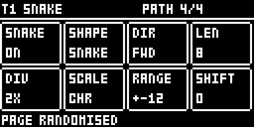

# DIGISNAKE for Digitakt

**This is the Digitakt version.** For the Elektron Digitone mk1 / Digitone Keys, use
[DIGISNAKE for Digitone](https://github.com/ClaidArremer/digitone-digisnake) instead: the files here do not run on a
Digitone, and the Digitone's do not run on a Digitakt.

A Cartesian step sequencer for the **Elektron Digitakt mk1**, after Maxime Dangles' MDD Snake and Make
Noise's René, as an [elekloader](https://github.com/irpina/elekloader) mod (id `digisnake-dt`). Eight cells
sit in a 4 × 2 grid that matches knobs A–H; a path, the snake, walks the grid and each sequencer step plays
the cell it lands on. It runs on all 8 audio tracks (a note is the sample's pitch, like a note lock) and the
8 MIDI tracks, for external gear.

By Robbie (tested on a Digitakt mk1, OS 1.54). GPL-2.0-or-later.

**DIGISNAKE carries on in [DIGISEQ for Digitakt](https://github.com/ClaidArremer/digitakt-digiseq)**, as its SNAKE
type, unchanged, next to a second sequencer type, 185 (a stage sequencer after ML-185). Each track picks its own
type there. Use one or the other, not both: DIGISEQ replaces DIGISNAKE in a build. DIGISNAKE for Digitakt 0.3
stays here for builds without DIGISEQ.

> Unofficial and unsupported. Flashing modified firmware is at your own risk; the stock Digitakt OS always
> recovers the unit (send the stock .syx from the boot menu).

| NOTES | GATES | PATH |
|---|---|---|
|  |  |  |

## What you need

| | |
|---|---|
| Unit | **Digitakt mk1** (not the Digitakt II) |
| OS | **1.54** (tested on a unit). A 1.53 build is included (run in an emulator, not on a unit) |
| Mods | elekloader's Digitakt **core** (3.0 or later; the app's own is fine, or the core 4.1 that [PUMP for Digitakt](https://github.com/ClaidArremer/digitakt-pump) needs), and **seq-events** (0.1) for the Digitakt, included here in `elemods/` |

## Install

In the elekloader app, add both files for your OS from `elemods/`: `digisnake-dt-0.3-os1.54.elemod` and
`seq-events-dt-0.1-os1.54.elemod` (or the two `-os1.53` files). Tick both, keep the app's core ticked,
build, and send the firmware to the Digitakt. From the command line:

```
python -m elekloader.patch --stock Digitakt_OS1.54.syx \
  --mod core-4.1-os1.54.elemod --mod elemods/seq-events-dt-0.1-os1.54.elemod \
  --mod elemods/digisnake-dt-0.3-os1.54.elemod --out Digitakt_digisnake.syx
```

It combines with other Digitakt mods: tested on a unit in one build with
[PUMP for Digitakt](https://github.com/ClaidArremer/digitakt-pump) 1.3, DH-101, Digi Mono, digihealth and the
LØST LVLS boot splash.

## Opening it

Press **TRIG** twice: the first press shows the Digitakt's TRIG page, the second opens Snake (however long
it is held). TRIG again goes back to the TRIG page; another page key goes to its page, and a menu opening
over the pages (GLOBAL, the pattern menu ...) closes it. Turn the track's **SNAKE** on (PATH page, knob A)
and it plays the snake in place of its own trigs; lock trigs still play.

## Pages

**LEFT / RIGHT** move between the four pages. On NOTES, GATES and VELOCITY, knobs A–H are the eight cells.
The small number in each cell's corner is its place on the path; the thick frame is the playhead.

| Page | Knobs A–H | Also |
|---|---|---|
| NOTES | Each cell's note, −24 to +24 semitones from the track's NOTE, quantised to SCALE | UP / DOWN: all notes a semitone (FUNC: an octave). FUNC + knob: −24 / −12 / 0 / +12 / +24 |
| GATES | Each cell plays or rests | Trig keys 1–8 toggle a cell (hold TRK to select tracks as usual). UP / DOWN: rotate |
| VELOCITY | Each cell's velocity, 1–127 | UP / DOWN: all up or down. FUNC + knob: 1 / 32 / 64 / 96 / 127 |
| PATH | The settings below | |

| Knob | PATH setting | Values |
|---|---|---|
| A | SNAKE | On or off for this track |
| B | SHAPE | ROWS, SNAKE, COLS, ZIGZAG, DIAG, CORNER, HOP |
| C | DIR | FWD, BWD, F/B, B/F, RND |
| D | LEN | Path length, 1–8 cells |
| E | DIV | 1/8, 1/4, 1/2, 1X, 2X. At 1/2 the snake plays every other step, at 1/4 every fourth. 2X runs the track at twice its own speed and needs the pattern in per-track SCALE mode (FUNC + PAGE); DIGISNAKE puts the track's speed back when 2X or SNAKE goes off |
| F | SCALE | CHR, MAJ, MIN, DOR, PHR, LYD, MIX, HMIN, PENT, mPNT, BLUE, WHOL, rooted on the track's NOTE |
| G | RANGE | The spread of randomised notes, ±1–24 semitones (FUNC + knob: 1 / 12 / 24) |
| H | SHIFT | Where on the path the snake starts, 0–7 |

## Keys

PAGE is the TRIG key, held. Short messages show on the Snake page's bottom line.

| Keys | What happens |
|---|---|
| PAGE + YES | Randomise the page shown (PATH: all but SNAKE and SCALE), as often as you like |
| PAGE + NO | Back to how the track was when PAGE went down |
| PAGE + PLAY | Clear the page: notes 0, gates on, velocity 100, PATH defaults (SNAKE kept) |
| PAGE + REC | Copy the page shown |
| PAGE + STOP | Paste it onto this track, audio or MIDI (PATH keeps this track's SNAKE) |
| PAGE + FUNC + REC | **Print**: write the snake into the track's own trigs, notes and velocities over the track's length, then turn SNAKE off |
| FUNC + YES | Randomise NOTES, GATES and VELOCITY together |
| FUNC + NO | Back to before the last run of FUNC + YES |
| FUNC + knob | Jump to preset values (NOTES, VELOCITY, RANGE) |

Print keeps lock trigs and parameter locks, and a 2X track stays at 2X. With DIR on RND it freezes one
random run.

## How it differs from DIGISNAKE for Digitone

- **Not saved with the project.** The Digitakt's core has no project storage yet: the snakes reset on
  power-off and project load. PRINT keeps a sequence.
- **Its own page, drawn over the screen.** The Digitakt core cannot add a page to TRIG, so the Snake page is
  drawn over the TRIG page; short messages show on its bottom line instead of a drop-down.
- **No Mod Menu** (the Digitakt core has none).
- **Scales** are rooted on the track's NOTE (the Digitakt has no keyboard ROOT).

## With DIRECT JUMP

With [DIRECT JUMP for the Digitakt](https://github.com/ClaidArremer/digitakt-directjump) (digitakt-directjump 1.0)
in the build, a pattern started by its START ON BAR (from step 1 on the next bar line, or the playing pattern
relaunched on the beat) starts every snake from the beginning of its path too, so the whole groove relaunches
together. A legato jump leaves the snakes walking. Without DIRECT JUMP nothing changes. Tested on a Digitakt
mk1 (OS 1.54).

## Changes

- **0.3**: snakes relaunch with DIRECT JUMP's pattern starts.
- **0.2**: the 2X division; PRINT writes velocities.
- **0.1**: the first version, ported from DIGISNAKE for Digitone 1.2.

## How it works

DIGISNAKE uses seq-events' step-fire events: `ev_gen_trig` decides whether a step fires, `ev_gen_notes` its
note and `ev_fire_vel` its velocity, so the Digitakt's own sequencer plays everything (timing, note length,
locks). The page reads the key dispatcher's screens (its brain, the first argument of each key event) to
know when the TRIG page is up, and draws over it from `ev_draw`. PRINT and 2X write the active pattern: 911
bytes a track, its step words at +0, each step's VEL at +0x80 (255: the track's), note lock 1 at +0x280, the
track's SCALE at +0x38b; the pattern pointer and the transport are the per-OS addresses seq-events uses
(`mod.json`'s cflags). The pattern offsets were measured in digiemu by changing a value on the unit and
comparing the pattern before and after. DIRECT JUMP's count of pattern starts, `dj_starts`, is a weak import:
a build without DIRECT JUMP links it to core's zero word.

## Building

With elekloader and an m68k cross GCC on the path:

```
python -m elekloader.sdk.build --stock Digitakt_OS1.54.syx .
```

## Credits and third-party code

DIGISNAKE for Digitakt is Robbie's own work, written with Claude (Anthropic); every line of
`digisnake_dt.c` is new. The idea, a path walking a grid of steps, comes from **MDD Snake** (Maxime Dangles'
free Max for Live device) and **Make Noise René**; no code from either. The random numbers use Marsaglia's
xorshift, a public algorithm.

It builds against irpina's [elekloader](https://github.com/irpina/elekloader) SDK headers and runs on its
Digitakt core and seq-events (GPL-2.0-or-later). The core is not included here. seq-events is: the two
`elemods/seq-events-dt-0.1-*.elemod` files are unmodified builds of elekloader's `mods/seq-events-dt1`
(GPL-2.0-or-later, by elekloader's contributors), made from
[its source at commit b9006bf](https://github.com/irpina/elekloader/tree/b9006bf8b7c4e69becd7e2f16ec6b20ea52b8982/mods/seq-events-dt1),
because the elekloader app does not ship seq-events yet. They carry only that mod's own code and no Elektron
code. The firmware addresses in `mod.json` and the pattern layout DIGISNAKE prints into were found by
studying the Digitakt's own OS so the mod can work with it; no Elektron code is included.

## Trademarks

Elektron, Digitakt and Digitone are trademarks of Elektron Music Machines; Make Noise and René of Make
Noise; Max for Live of Ableton AG and Cycling '74. They are named only to say what this works with or was
inspired by. This project is not affiliated with or endorsed by any of them.

## Licence

GPL-2.0-or-later, see [LICENSE](LICENSE).
